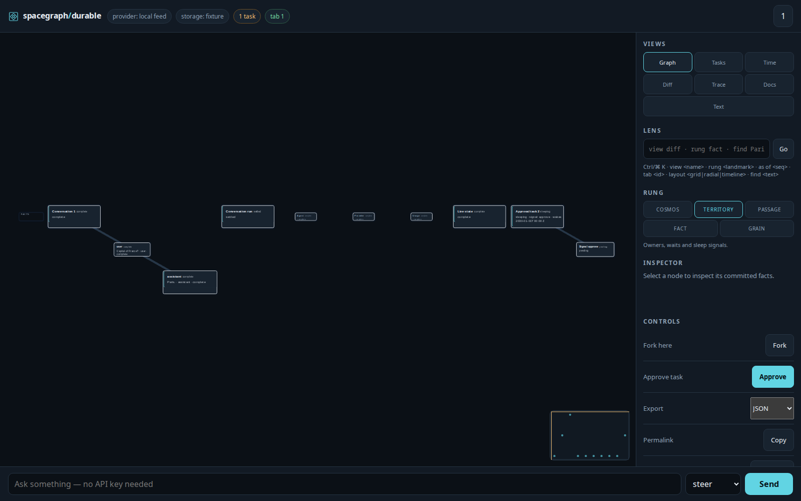

# SpaceGraphJS

**A zoomable user interface engine for spatial software.**  
Render graphs in 2D or 3D, treat every object as a node, and let the interface verify its own visual quality.

SpaceGraphJS is built on WebGL and a dependency-free renderer contract, so the same graph can run in the SpaceGraph adapter, a Cytoscape fallback, or a static SVG export.

---

## 🌌 What It Is

Most interfaces are pages. SpaceGraphJS treats an interface as a **navigable graph**:

- **Nodes** are content, controls, media, documents, or entire subgraphs.
- **Edges** express relationships and flow.
- **Zoom** is navigation: overview first, detail on approach.
- **Vision** closes the loop: analyze the render, report issues, correct or patch.

It works as a full engine (`spacegraphjs`), as a lean canvas entry (`spacegraphjs/activity`), or as the rendering layer inside another host through `@spacegraphjs/renderer`.

| Pillar                 | What it gives you                                                                                             |
| ---------------------- | ------------------------------------------------------------------------------------------------------------- |
| 🎨 **Spatial canvas**  | Infinite pan/zoom, orthographic or perspective camera, on-demand or continuous rendering                      |
| 🧱 **Rich primitives** | Shapes, text, HTML, Markdown, code editors, images, video, audio, charts, 3D globes, form controls            |
| 🔗 **Relation model**  | Curved, dotted, flow, bundled, animated, labeled, and inter-graph edges                                       |
| 🧠 **Layout**          | Force, hierarchical, tree, radial, circular, grid, spectral, cluster, timeline, geo, and headless lane layout |
| 👁️ **Vision**          | Legibility, overlap, hierarchy, and ergonomics analysis with auto-fix                                         |
| 🎮 **Interaction**     | Selection, focus, fit, navigation trail, semantic zoom bands, search, graph queries                           |
| ♿ **Accessibility**   | Hidden DOM mirror, roving tabindex, keyboard traversal, live announcements, RTL support                       |
| 🧩 **Extensibility**   | Plugin system, custom node/edge types, custom layouts, renderer adapters                                      |
| 🧭 **Host contract**   | Framework-agnostic `RenderModel`, capability negotiation, React/Solid bindings                                |

---

## 📊 Project Status

**Alpha.** The rendering core, node and edge libraries, layout plugins, plugin system, camera and input handling, vision analyzers, renderer contract, adapters, and framework bindings are implemented. The project is currently in a developer-experience and API-stability pass before a stable release.

Practical expectations:

- Public APIs may still move. Pin a version for production use.
- Heuristic vision analysis works today. The ONNX inference path is wired, but model weights are still being finalized.
- The renderer contract is versioned and negotiable; adapters declare what they support.
- Issues and design discussion are welcome while the surface stabilizes.

---

## 🎯 Why It Exists

Traditional UI work separates the builder from the viewer:

| Conventional loop | Vision-closed loop      |
| ----------------- | ----------------------- |
| Write code        | Specify the graph       |
| Open a browser    | Render the graph        |
| Inspect visually  | Analyze the render      |
| Guess at the fix  | Correct or emit a patch |
| Repeat            | Repeat only when needed |

The important idea is not autonomous replacement of the developer. It is **making visual quality observable to the system that produced it**. A graph engine can measure contrast, overlap, hierarchy, and target size because it owns the scene. That makes visual regressions testable, and it makes self-correction possible.

---

## 🏗️ Architecture

| Layer                | Responsibility                                        | Key pieces                                                                                                                    |
| -------------------- | ----------------------------------------------------- | ----------------------------------------------------------------------------------------------------------------------------- |
| **Host application** | Owns domain data, persistence, detail panels, routing | Your React, Solid, or vanilla app                                                                                             |
| **Bindings**         | Lifecycle, controller wiring, framework reactivity    | `GraphBinding`; `react-spacegraph` and `solid-spacegraph` over the contract                                                   |
| **Contract**         | Dependency-free types and capability negotiation      | `@spacegraphjs/renderer` — `GraphRenderer`, `RenderModel`, `RenderTheme`, `supports`                                          |
| **Adapters**         | Geometry, hit-testing, camera, rendering              | `@spacegraphjs/spacegraph-renderer` (2D + 3D), `@spacegraphjs/cytoscape-renderer` (2D), `@spacegraphjs/svg-renderer` (static) |
| **Core engine**      | Graph model, WebGL renderer, plugins, input, vision   | `spacegraphjs` — `SpaceGraph`, `Graph`, `WebGLRenderer`, `PluginManager`, `VisionManager`                                     |
| **Platform**         | GPU, browser APIs, optional inference                 | Three.js, WebGL, ONNX Runtime Web                                                                                             |

Two ways to adopt it:

| Mode              | You import                                | You own                                                        |
| ----------------- | ----------------------------------------- | -------------------------------------------------------------- |
| **Full engine**   | `spacegraphjs`                            | Little: the engine owns the graph, camera, plugins, and vision |
| **Host contract** | `@spacegraphjs/renderer` plus one adapter | Data mapping, positions, persistence, detail UI, layout policy |

The data path is deliberately narrow:

**your domain model → host adapter → `RenderModel` → contract renderer → canvas or SVG**

Design rules that keep the layers honest:

- The core **never imports** the renderer contract. Adapters are thin leaves.
- Absolute positions are authoritative. The renderer never auto-layouts.
- Events carry string IDs and primitives. No library objects cross the boundary.
- HTML is host-provided and sanitized. The renderer positions markup; it never evaluates it.
- Hosts own persistence, routing, and detail content. The library keeps no session state.
- Capabilities are checked before an affordance is offered. Unsupported actions are disabled with an explanation.

---

## 📦 Package Map

| Package                                                                                       | Role                                                               |
| --------------------------------------------------------------------------------------------- | ------------------------------------------------------------------ |
| `spacegraphjs`                                                                                | Full engine: nodes, edges, layouts, plugins, vision, ergonomic API |
| `spacegraphjs/activity`                                                                       | Lean entry that keeps `three` off the critical path                |
| `spacegraphjs/core`, `/nodes`, `/edges`, `/plugins`, `/input`, `/utils`, `/builder`, `/types` | Focused subpath exports                                            |
| `spacegraphjs/zoom`, `/layout`, `/a11y`, `/navigation`, `/depth`, `/control`                  | Generic capabilities with minimal structural types                 |
| `spacegraphjs/reading`, `/documents`, `/composer`                                             | Text projections, safe document rendering and the prompt editor    |
| `spacegraphjs/vision`                                                                         | Vision analyzers, strategies, auto-fix, model loading              |
| `@spacegraphjs/renderer`                                                                      | Dependency-free renderer contract                                  |
| `@spacegraphjs/adapter`                                                                       | Host-agnostic model → `RenderModel` pipeline and conformance suite |
| `@spacegraphjs/spacegraph-renderer`                                                           | SpaceGraph adapter: orthographic 2D and perspective 3D             |
| `@spacegraphjs/cytoscape-renderer`                                                            | Cytoscape adapter: 2D fallback and benchmark                       |
| `@spacegraphjs/svg-renderer`                                                                  | Static SVG export and inline subgraphs; not interactive            |
| `react-spacegraph`                                                                            | `GraphView` binding over the contract and controller               |
| `solid-spacegraph`                                                                            | Solid binding over the same policy                                 |
| `@spacegraphjs/cli`                                                                           | `sg fix`: apply vision-generated patches                           |
| `create-spacegraph`                                                                           | Scaffolder, also exposed as `sg6`                                  |

---

## 🚀 Getting Started

Install with `pnpm add spacegraphjs three`. Three.js is a required peer. Optional peers activate specific nodes: `chart.js` for charts and `katex` for math. Markdown renders through the built-in safe `spacegraphjs/documents` primitive.

### Your first graph

1. Put a container in the DOM and give it real dimensions.
2. Import `SpaceGraph` from `spacegraphjs`, or from `spacegraphjs/activity` for a lean canvas.
3. Build a spec with nodes (`id`, `type`, `label`, `position`, `data`) and edges (`id`, `source`, `target`).
4. Await `SpaceGraph.create(container, spec, options)`. It initializes the engine and loads the graph.
5. Call `render()`. In the default on-demand mode, later mutations repaint automatically.
6. Use `fitView()`, `focusNode(id)`, `select(id)`, or `setPositions(...)` to frame and drive the scene.

### See it run

Run `pnpm run dev:demo` and open `/` for the complete demo: a capability gallery, 44 programmatic demos at `/showcase.html`, and every standalone feature page. `pnpm run dev` serves the engine demos.

The OpenCode host demo (`pnpm run graph:dev`, the real shell against a canonical fixture with no model provider) and the component-test harness are indexed next to it in `docs/spacegraph/demos.md` of the OpenCode fork.

### Most-used calls

| Goal     | Call                                                                  |
| -------- | --------------------------------------------------------------------- |
| Create   | `SpaceGraph.create(container, spec, options)`                         |
| Render   | `graph.render()`                                                      |
| Add      | `graph.addNode(...)`, `graph.addEdge(...)`                            |
| Query    | `graph.$(id)`, `graph.findNodes(...)`, `graph.neighbors(id)`          |
| Frame    | `graph.fitView()`, `graph.focusNode(id)`, `graph.center(x, y, z)`     |
| Select   | `graph.select(ids)`, `graph.toggleSelection(id)`, `graph.selectAll()` |
| Batch    | `graph.batch(fn)`, `graph.transaction(fn)`                            |
| React    | `graph.watch(event, callback)`                                        |
| Persist  | `graph.export()`, `graph.import(data)`                                |
| Teardown | `graph.dispose()`                                                     |

### Common options

| Option              | Effect                                                                            |
| ------------------- | --------------------------------------------------------------------------------- |
| `render.renderMode` | `on-demand` (default) or `continuous`                                             |
| `render.projection` | `orthographic` or `perspective`                                                   |
| `render.depth`      | `flat`, `layered`, `depth-stack`, or `orbit`                                      |
| `theme`             | Background, node fill/stroke, edge colors, label typography, interaction outlines |
| `keyboard`          | `false`, `container` (default), or `window`                                       |
| `chrome`            | Enable HUD, minimap, and zoom UI chrome; off by default                           |
| `plugins`           | Extra plugin instances registered after defaults                                  |
| `global`            | Expose the instance for developer tooling; off by default                         |
| `vision`            | Heuristic thresholds and ONNX WASM paths                                          |

### Entry points

| Need              | Import                                                                       |
| ----------------- | ---------------------------------------------------------------------------- |
| Everything        | `spacegraphjs`                                                               |
| Lean graph canvas | `spacegraphjs/activity`                                                      |
| Contract only     | `@spacegraphjs/renderer`                                                     |
| Framework binding | `react-spacegraph`, `solid-spacegraph`                                       |
| Headless helpers  | `spacegraphjs/layout`, `/zoom`, `/navigation`, `/a11y`, `/depth`, `/control` |

### The host path

If you are embedding a graph in an existing product, avoid the full engine:

1. Map your data to a `RenderModel`.
2. Pick a renderer adapter and negotiate the contract version.
3. Mount it behind a dynamic import.
4. Bind a `GraphController` for selection, trail, bands, and search.
5. Mount `AccessibilityLayer` over the same node list.
6. Export with `renderToSVG` or serialize the model.

This path keeps your vocabulary, your layout policy, and your persistence out of the library.

### The demo

`app/demo/` is the complete library demo app. Its gallery runs every library surface against a
release-pipeline model; `/showcase.html` switches 44 programmatic demos without a rebuild.
`/learn.html` explains the model → adapter → renderer path with real snippets and links each
capability to the live gallery. The other pages cover scopes, the runtime explorer, the renderer
contract and the standalone features.

`/html/interaction/transcript.html` is the console/ZUI blend: a transcript rail and HTML-node graph
share one local event fixture. Selecting a row frames its card, selecting a card reveals its row,
and the errors/approvals filter, graph/transcript/hybrid surfaces and four palettes show the same
state through text and spatial views. Transcript cards own a tight, left-aligned terminal spine:
large monospace lines set their own width while every left edge stays fixed, and attached context
sits to the right as tiny satellites through `octaveLayout`; the spine-chain edges are nearly
invisible because position already reads as sequence. Zoom promotes detail without enlarging the
spine. The prompt loop is local — no provider and no network.

```
pnpm --filter demo dev   # then open http://localhost:5173
```

The **flagship** is `app/pi/`: a recursive, freeform zero-gravity agent run in 3D with a settling
scope simulation, capability-gated depth, a cinematic follow flight, a log/map/hybrid transcript and
five selector-backed investigative questions. It is a private workspace consumer — the library still
has no knowledge of the host. Its canonical fixture needs no provider.

```
PI_LOCAL_FEED=1 pnpm --filter pi dev   # provider-free flagship
pnpm --filter pi test                  # fold, selectors, scopes, capabilities, study protocol
pnpm --filter pi verify:visual         # vision-gated capture matrix
pnpm --filter pi verify                # one-way dependency guard
```

The flagship has a **screenshot studio**. A shot is data (`app/pi/src/shots.ts`): scenario, preset,
policy, surface and camera framing; `?shot=node-detail` launches exactly that view. Twelve shots cover
the LOD close-up, a deep focus lens and recursive inner layouts, zoom dynamic range, three surface
arrangements, view palettes and backdrops, the light theme, and the proof/policy surfaces. Node size
is never changed by default: `emphasis.focusScale` and its neighbors are opt-in knobs, and the detail
lens is a fixed-size host overlay anchored to the focused node with clickable inner chips and actions.
Causal edges are thick faceted ribbons through the existing `RenderEdge.data` path. The catalog and
rail are on-demand drawers and all surfaces use square corners, so the canvas keeps the reclaimed width.

A second private consumer, [`app/pi-durable/`](app/pi-durable/README.md), renders durable Pi sessions
as a navigable workspace: one server-owned Harness, one SSE stream, per-conversation kernels and a tab
switcher that restores state instead of remounting a run. It runs with a faux provider and no API key,
and ships tracked screenshots as soon as its Core runs. The same folded kernel has three scoped
placements — graph, task tree and timeline — and `?scenario=<id>` opens one named Core or Next case.



```
pnpm --filter pi-durable dev           # provider-free durable demo
pnpm --filter pi-durable verify:fast   # types, fold tests and browser journey
pnpm --filter pi-durable shots:focus   # four tracked, vision-gated Core shots
pnpm --filter pi-durable shots:all     # every Core and Next scenario shot
```

Both hosts are private workspace consumers. SpaceGraphJS itself knows neither Pi nor either host's
state machine; only the pipeline (`app/pi-kit`) is shared.
`pnpm --filter pi shots:all` regenerates the curated
gallery in [`docs/screenshots/`](docs/screenshots/README.md); `pnpm --filter pi shot --watch`
recaptures on source change and refreshes a local contact sheet, so visual iteration needs no manual
camera driving or server restart. Palette, backdrop and glow are `theme.*` policy knobs with presets,
not renderer branches; the HUD stays grayscale while color lives in the view.

A shareable landing page with a clip, screenshots and the one-command quickstart lives at
[`app/demo/flagship.html`](app/demo/flagship.html) (served by `pnpm --filter demo dev` and included in the
demo build; `pnpm --filter demo video:flagship` recaptures the clip). The compositional demo at
[`compositional-wrappers.html`](app/demo/html/layout/compositional-wrappers.html) mounts the agent and
workflow domains in one workspace and joins them with an `InterGraphEdge` overlay; each model stays isolated.

The semantic-wrapper recipe that produced the flagship is documented in
[`docs/semantic-wrappers.md`](docs/semantic-wrappers.md); the five-task study protocol and harness are
in [`docs/pi-study.md`](docs/pi-study.md). A second domain (`@spacegraphjs/workflow`) proves the recipe.

| Capability                               | Library surface                                                                                       |
| ---------------------------------------- | ----------------------------------------------------------------------------------------------------- |
| The renderer contract                    | `@spacegraphjs/renderer`                                                                              |
| Theme and contrast                       | `@spacegraphjs/renderer`                                                                              |
| The three renderers                      | `@spacegraphjs/spacegraph-renderer`, `@spacegraphjs/cytoscape-renderer`, `@spacegraphjs/svg-renderer` |
| The model adapter                        | `@spacegraphjs/adapter`                                                                               |
| Semantic levels                          | `spacegraphjs/levels`                                                                                 |
| Layout strategies                        | `spacegraphjs/layout`                                                                                 |
| Summary representations                  | `spacegraphjs/representations`                                                                        |
| Search, minimap, trail, typed-edge paths | `spacegraphjs/navigation`                                                                             |
| Zoom bands, controller                   | `spacegraphjs/control`, `spacegraphjs/zoom`                                                           |
| The accessibility mirror                 | `spacegraphjs/a11y`                                                                                   |
| The depth spectrum                       | `spacegraphjs/depth`                                                                                  |
| The scoped overlay                       | `spacegraphjs/overlays`                                                                               |
| The code diff                            | `spacegraphjs/overlays`                                                                               |

Its checks live with the app: `app/demo/tests/host.test.ts` runs every capability against the real
model, and `app/demo/tests/host.spec.ts` drives the page in a browser. `test/e2e/` covers the static
pages.

### Renderer contract

The contract is types plus tiny helpers, small enough to read in one sitting.

| Contract piece         | Purpose                                                                                                                                |
| ---------------------- | -------------------------------------------------------------------------------------------------------------------------------------- |
| `GraphRenderer`        | `mount`, `setModel`, `setTheme`, `setProjection`, `setDepth`, `setSelection`, `setViewport`, `fit`, `focus`, `resize`, `on`, `dispose` |
| `RenderModel`          | `nodes`, `edges`, optional `extent`                                                                                                    |
| `RenderNode`           | `id`, `kind`, `label`, `summary`, `html`, `position`, `size`, `status`, `visible`, `interactive`, `shape`, `data`                      |
| `RenderEdge`           | `id`, `source`, `target`, `kind`, `label`, `confidence`, `visible`, `directed`, `style`                                                |
| `RenderTheme`          | Colors, typography, and `direction`                                                                                                    |
| `RendererCapabilities` | Projections, depths, DOM node support, edge labels, clusters, minimap, recommended limits                                              |
| `RendererEventMap`     | `ready`, clicks, double-click, background, hover, selection, viewport, band, error                                                     |

Gate affordances with `supports(capabilities, ...)` and `supportsDepth(capabilities, ...)`. The additive capability surface is versioned by `LIBRARY_CONTRACT_VERSION`; negotiate capability, never renderer identity. Renderers must no-op on an unsupported depth mode, never throw. Absolute positions are authoritative; `data` is serializable; HTML is sanitized by the host; no library objects cross the boundary.

A host typically maps data, dynamic-imports one adapter, probes capability, mounts with a theme and projection, pushes model and view state, subscribes to events, and disposes on unmount. A failed mount can fall back to another adapter on the same container with the model intact.

---

## 🧱 Core Data Model

| Type                | Fields                                                  |
| ------------------- | ------------------------------------------------------- |
| **Node**            | `id`, `type`, `label`, `position` (`[x, y, z]`), `data` |
| **Edge**            | `id`, `type`, `source`, `target`, `label`, `data`       |
| **GraphSpec**       | `nodes`, `edges`                                        |
| **SpecUpdate**      | Partial node and edge updates by `id`                   |
| **GraphImportData** | Spec plus optional `camera` and plugin state            |

Per-node flags live in `data` and are honored by the engine: `visible`, `draggable`, `selectable`, `pinned`.

Export captures positions, node data, edge data, camera pose, and plugin state. Import replaces the graph and restores the camera. Stable IDs are the contract that makes updates, selection, and the navigation trail survive.

---

## 🧩 Node Library

| Category             | Types                                                                                                                                                           |
| -------------------- | --------------------------------------------------------------------------------------------------------------------------------------------------------------- |
| **Shapes and text**  | `ShapeNode`, `TextMeshNode`, `TexturedMeshNode`, `InstancedShapeNode`, `InstancedNode`                                                                          |
| **Content**          | `HtmlNode`, `DOMNode`, `MarkdownNode`, `MermaidNode`, `CodeEditorNode`, `IFrameNode`, `NoteNode`                                                                |
| **Media**            | `ImageNode`, `VideoNode`, `AudioNode`, `CanvasNode`, `GlobeNode`                                                                                                |
| **Data and process** | `ChartNode`, `GridNode`, `VirtualGridNode`, `DataNode`, `ProcessNode`                                                                                           |
| **Controls**         | `ButtonNode`, `ToggleNode`, `SwitchNode`, `SliderNode`, `ColorPickerNode`, `DropdownNode`, `ProgressBarNode`, `MeterNode`                                       |
| **Structure**        | `GroupNode`, `PanelNode`, `BorderNode`, `LayoutNode`, `SplitNode`, `StackingNode`, `PortNode`, `SceneNode`, `WidgetNode`, `TabContainerNode`, `ScrollPanelNode` |

Most of these types are registered by default and usable by type name; constructors are also exported from `spacegraphjs/nodes` where available. `LayoutNode` exposes border, grid, split, stacking, and switch strategies. `InstancedNode` and `InstancedShapeNode` batch repeated geometry for dense scenes.

All nodes share `id`, `type`, `label`, `position`, and `data`. Optional peers activate chart, math, Markdown, and code-editor content.

---

## 🔗 Edge Library

| Type                   | Use                              |
| ---------------------- | -------------------------------- |
| `Edge`                 | Straight connection              |
| `Wire`                 | Minimal wire                     |
| `CurvedEdge`           | Smooth curve                     |
| `DottedEdge`           | Dotted or dashed relation        |
| `FlowEdge`             | Directional flow animation       |
| `BundledEdge`          | Hierarchical bundling            |
| `AnimatedEdge`         | Custom animation loop            |
| `DynamicThicknessEdge` | Thickness encodes data           |
| `LabeledEdge`          | Text label on the connection     |
| `InterGraphEdge`       | Reference across graph instances |

Edges resolve only nodes in the same graph. Graph instances are isolated at the model level; `InterGraphEdge` renders a screen-space overlay for cross-canvas presentation but does not merge graph models.

---

## 🧠 Layout

| Layout               | Best for                                  |
| -------------------- | ----------------------------------------- |
| `ForceLayout`        | Organic clusters and physics feel         |
| `HierarchicalLayout` | Dependencies, org charts, directed flow   |
| `TreeLayout`         | Strict trees                              |
| `RadialLayout`       | Hub-and-spoke and mind maps               |
| `CircularLayout`     | Cycles and rings                          |
| `GridLayout`         | Matrices and calendars                    |
| `SpectralLayout`     | Spectral graph drawing                    |
| `ClusterLayout`      | Community grouping                        |
| `TimelineLayout`     | Temporal sequences                        |
| `GeoLayout`          | Geographic projection                     |
| `LaneLayout`         | Headless columns → X, rows → Y, depth → Z |
| `BaseLayout`         | Custom layout extension point             |

Two placement modes matter:

- **Plugin layouts** run when you invoke them with `layout(name)` or `layoutOnce(name)`; they do not re-run on every mutation. `AutoLayoutPlugin` is a default hook for vision-driven overlap repair, not a general auto-layout loop.
- **`LaneLayout`** is deterministic and append-only: placing a known ID returns its stored position, so streaming data never moves earlier items. It is a grid: columns advance on X, rows on Y, and every (column, row) cell keeps its own cursor, so a row advances by the widths of the items it holds while its neighbours stay put. A column's width is measured from the rows it holds, or declared when the host knows it up front. `spacegraphjs/layout` also exports `Strategies` — the lanes, timeline and hierarchy views — as policies over this one primitive.

`solveErgonomicLayout(nodes, edges, viewport, options?)` is the general, host-agnostic packing heuristic. It picks the column count whose grid aspect matches the surface, orders nodes by a bounded Cuthill–McKee-style tie heuristic, refines slots by swap passes that lower squared edge length, and returns solved positions plus measured `occupancy`, `meanEdgeLength`, `aspectFit`, `overlaps` and a `labelFloorMet` flag. No DOM, renderer, host vocabulary or hidden policy: supply node sizes, edges and a viewport, then compare candidates by score. `chooseColumns`, `orderByProximity` and `refineBySwaps` are exported separately for hosts that own their own solver.

`chapterPacking(ids, { card, gap?, columns?, viewport?, previous? })` is the small-grid sibling: it packs a handful of chapter cards, caps the column count to the viewport, and keeps cards already placed in `previous` in their cells so a streamed chapter does not reshuffle the view. The ids are plain strings — no domain vocabulary or renderer is involved. `app/pi` uses it for turn subgraphs; `app/demo/second-host.ts` uses the same helper with non-agent ids. That is the pattern for taking a flagship behavior into another domain: promote the placement rule into `spacegraphjs/layout`, keep the vocabulary in the host, and prove it with a second consumer.

Hosts can always own placement directly with `setPositions(...)`, `pinAll(...)`, and `layoutOnce(...)`. Request a named layout explicitly when data arrives.

---

## 👁️ Vision

The vision system analyzes the scene the engine owns, then reports or corrects issues.

> **Render → Analyze → Score → Correct or patch → Re-render**

| Analyzer             | Checks                                   |
| -------------------- | ---------------------------------------- |
| `LegibilityAnalyzer` | WCAG contrast, text legibility           |
| `OverlapAnalyzer`    | Node penetration and overlapping regions |
| `HierarchyAnalyzer`  | Root presence, depth, level clarity      |
| `ErgonomicsAnalyzer` | Target sizes and Fitts' Law compliance   |

| Strategy     | Behavior                                        |
| ------------ | ----------------------------------------------- |
| `heuristics` | Fast, deterministic checks; the working default |
| `onnx`       | Model inference through ONNX Runtime Web        |
| `hybrid`     | Combines heuristic and model results            |

The heuristic path is the supported default. ONNX loading, execution providers, and model management are implemented, but the shipped weights are placeholders while the training pipeline is finalized. Treat ONNX scoring as experimental until that lands.

A `VisionReport` carries a legibility result, an overlap result, a hierarchy result, an ergonomics result, and an overall score with a grade and categorized issues.

### The loop

1. **Analyze** with `graph.vision.analyzeVision()`, which returns a `VisionReport`.
2. **Inspect** the overall score, grade, and categorized issues.
3. **Correct** with `graph.vision.autoFix(category, report)`.
4. **Automate** with `graph.vision.startAutonomousCorrection()` and `graph.vision.stopAutonomousCorrection()`.
5. **Apply a report** with `graph.vision.applyAutonomousFixes(report)`.

Model management uses `graph.vision.loadModels(paths)` and `graph.vision.modelsLoaded`; `graph.vision.strategy` reports the active strategy.

### Quality gates

- `checkQuality(spec)` scores a graph spec and returns the issues behind that score.
- `spacegraphVision(spec, { minScore })` returns the same report plus `passed` and a letter `grade`; it does not throw.
- `visionAssert(spec)` returns test assertions: `noOverlap()`, `noMissingLabels()`, `noInvalidEdges()`, `withinDomBudget()`, `accessible()` and `meetsFloor(minScore)`.
- `correctQuality(spec, { maxEdits })` applies only measured, re-verified fixes; preferences are logged, never flipped.
- `sg fix` consumes a `spacegraph-autofix-patch.json` when a host supplies one, with a `--dry-run` mode.
- `VisionOverlayPlugin` surfaces scores and fixes inside a running app.

Vision is a verification tool, not a guarantee. Use it alongside unit, interaction, and visual-regression tests.

---

## 🎮 Interaction and State

`GraphController` is the framework-agnostic state machine shared by hosts. It owns no DOM and does not own the renderer lifecycle.

| Concern           | Surface                                                               |
| ----------------- | --------------------------------------------------------------------- |
| **Selection**     | `select`, `toggle`, `clear`; `selection` and `selectedNode` getters   |
| **Focus and fit** | `focus(id)`, `fit(ids, options)` — `minScale`, `padding`, `insets`    |
| **Trail**         | `back()`, `forward()`, `trail`; reconciles by ID across model updates |
| **Semantic zoom** | `bands`, `band`, `zoom`, `feedNormalized(zoom)`                       |
| **Search**        | `search(query, limit)` ranked by label, summary, kind, then ID        |
| **Queries**       | `connections(id)` for incident edges and neighboring nodes            |
| **Reactivity**    | `onChange(snapshot)` emits on selection, trail, or band changes       |
| **Lifecycle**     | `bind(renderer)`, `unbind()`, `dispose()`                             |

`GraphBinding` wraps the controller and the renderer lifecycle for one container. It owns `mount`, updates, and `dispose`; a mount that resolves after unmount disposes its own renderer, so it is StrictMode and HMR safe. React and Solid bindings are thin wrappers over it.

### The mouse

The mouse map belongs to the library, so every host gets the same gestures. A host that draws its own cards over the canvas inherits them.

| Gesture                            | Does                                                               |
| ---------------------------------- | ------------------------------------------------------------------ |
| **Right button + drag**            | Pan the view; the view follows the cursor at every zoom            |
| **Left button + drag on the void** | Pan the view; over the void the left button has nothing else to do |
| **Wheel**                          | Zoom about the point under the pointer                             |
| **Middle click on a node**         | Frame that node (auto-zoom, half a second)                         |
| **Middle button + drag**           | Orbit (a perspective view only; an orthographic view has no orbit) |
| **Left click on a node**           | Select it                                                          |
| **Left drag on a node**            | Move it                                                            |
| **Shift + drag on the void**       | Box-select                                                         |

A host that wants the left button to mean only "the nodes" turns the void's pan off with `input: { interaction: { enableBackgroundPan: false } }`.

A control inside a card (`data-sg-interactive="true"`, or any form control) takes the mouse: the card does not move under it, and the card's own background still drags the card. A card draws its hover as an outline around itself, so hovering never moves the controls under the reader's finger.

---

## ♿ Accessibility

`AccessibilityLayer` builds a visually hidden, ordered DOM mirror of the graph.

- Roving tabindex with Arrow Up/Down, Home, and End.
- Enter or Space activates an item; Escape is host-defined.
- `aria-live` announces selection changes.
- Non-interactive items are listed but skipped by traversal.
- The contract theme carries `direction: 'rtl'`; adapters honor it for SVG and DOM cards without mirroring graph coordinates.

Pass it the same minimal node list the renderer uses: `id`, `label`, `kind`, `status`, `interactive`.

---

## 🔍 Zoom, Depth, and Projection

| Capability         | Surface                                                                                  |
| ------------------ | ---------------------------------------------------------------------------------------- |
| **Zoom**           | `zoom` (normalized 0..1), `setZoom(value)`, `viewport`                                   |
| **Semantic bands** | `ZoomBands` maps normalized zoom to named bands with hysteresis                          |
| **Projection**     | `projection`, `setProjection('orthographic' \| 'perspective')`                           |
| **Depth**          | `depth`, `setDepth(mode)`; modes are `flat`, `layered`, `depth-stack`, `orbit`           |
| **Depth fade**     | `applySceneFade()` uses content depth and camera distance, not absolute distance         |
| **Orbit control**  | `setOrbitEnabled(enabled)`, `setPolar(phi, theta, duration)`                             |
| **Camera**         | `fitView`, `focusNode`, `center`, `resetCamera`, `setCamera`, `camera`, `cameraPosition` |

`flat` is the orthographic baseline. `layered` and `depth-stack` add readable perspective ordering. `orbit` is the free-perspective experiment. Depth is a spectrum, not a 2D/3D switch.

---

## 🎨 Theming

The core theme is a small token object:

| Token group                                             | Controls                         |
| ------------------------------------------------------- | -------------------------------- |
| `background`                                            | Scene background                 |
| `node.fill`, `node.stroke`                              | Default node surface and outline |
| `edge.color`, `edge.labelColor`, `edge.labelBackground` | Edge stroke and label treatment  |
| `label.color`, `label.fontFamily`, `label.fontSize`     | Shared label typography          |
| `selection`, `hover`, `focus`                           | Interaction outlines             |

The contract's `RenderTheme` is broader: surface, muted surface, text, muted text, border, accent, success, warning, error, edge, muted edge, selection, focus, font family, font size, and direction. Map your design tokens once and re-resolve on color-scheme change; remounting is not required.

The library never reads CSS custom properties. Pass resolved values.

---

## 🛠️ Developer Experience

### Declarative builder

`graph`, `node`, `edge`, `connect`, `layout`, `Presets`, `Patterns`, `Animate`, `Batch`, and `DataUtils` build specs without hand-writing JSON. Convenience factories cover shapes and controls: `box`, `circle`, `sphere`, `button`, `slider`, `toggle`, `widget`.

### Ergonomic API

The main `SpaceGraph` instance is also a fluent toolkit:

- **Access**: `$(id)`, `$$(id)`, `at(id)`, `must(id)`.
- **Query**: `findNodes`, `findNode`, `getNodesByType`, `findEdges`, `getEdgesForNode`, `where`, `has`.
- **Traversal**: `neighbors`, `adjacent`, `connections`, `inEdges`, `outEdges`, `traverse`, `bfs`, `dfs`, `path`, `getSubgraph`.
- **Mutation**: `addNode`, `addEdge`, `add`, `addNodes`, `addEdges`, `connect`, `connectTo`, `connectFrom`, `disconnect`, `remove`, `removeWhere`, `updateWhere`.
- **Iteration**: `forNodes`, `forEdges`, `forEach`, `each`, `map`, `filter`, `some`, `every`.
- **Node utilities**: `move`, `translate`, `shift`, `label`, `text`, `color`, `fill`, `data`, `attr`, `rotate`, `scale`, `setSize`, `opacity`, `clone`, `require`.
- **Visibility and flags**: `show`, `hide`, `toggle`, `visible`, `pinned`, `unpin`, `draggable`, `selectable`.
- **Batching**: `batch`, `transaction`, `freeze`, `suspend` coalesce renders.
- **Reactivity**: `watch(event, callback)` returns an unsubscribe function.

### Lifecycle

`init()`, `render()`, `pause()`, `resume()`, `dispose()`, and `destroy()` cover startup, frame control, and teardown. `SpaceGraph.create` is the async factory that initializes and loads in one step. `SpaceGraph.load`, `fromURL`, `fromManifest`, and `quickGraph` cover other data sources.

`fromManifest` reads `/.well-known/zui-manifest.json`, which can inline a spec or point to one.

### Events

The event system covers:

- Graph mutation: `node:added`, `node:removed`, `node:updated`, `edge:added`, `edge:removed`, `edge:updated`, `graph:cleared`.
- Interaction: `node:click`, `edge:click`, `background:click`, `node:dblclick`, `node:selection-changed`, `selection:changed`.
- Camera and view: `camera:change`, `zoom:change`, `zoomband:change`, `projection:change`, `depth:change`.
- Lifecycle and vision: `ready`, `vision:analysis-complete`.

### Export, import, persistence

- `export()` returns the spec plus camera and plugin state.
- `import(data)` replaces the graph and restores the camera.
- `loadSpec(spec)` and `update(spec)` add or patch in place.
- The contract side adds `serializeRenderModel`, `parseRenderModel`, `renderToSVG` (pure, runs in Node), and `InlineGraph`.
- Persistence is yours: persist selection, band, projection, and renderer choice in your own view state.

---

## 🔌 Plugins

| Plugin                           | Purpose                                              |
| -------------------------------- | ---------------------------------------------------- |
| `AutoColorPlugin`                | Harmony-aware color assignment and vision correction |
| `AutoLayoutPlugin`               | Re-layout and overlap repair                         |
| `HistoryPlugin`                  | Undo and redo                                        |
| `InteractionPlugin`              | Drag, click, hover, and interaction policy           |
| `HoverMetaWidget`                | Rich hover cards                                     |
| `HUDPlugin` / `DOMOverlayPlugin` | Heads-up display                                     |
| `LayoutContainer`                | Constrained layout regions                           |
| `LODPlugin`                      | Level-of-detail simplification                       |
| `MermaidPlugin`                  | Mermaid, DOT, GraphML, and JSON diagram parsing      |
| `MinimapPlugin`                  | Overview navigator                                   |
| `PhysicsPlugin`                  | Force simulation                                     |
| `VisionOverlayPlugin`            | Visual quality markers and fixes                     |
| `ZoomBandsPlugin`                | Band indicators                                      |
| `ZoomUIPlugin`                   | Zoom controls                                        |
| `ErgonomicsPlugin`               | Runtime ergonomics hints                             |

Plugins receive initialization, pre/post render, node and edge mutation, export/import, and disposal hooks. Core plugins are registered by default; add extra instances through `options.plugins`.

`ZoomBandsPlugin` and `ScaleDomain` are the band/scale mechanism and re-emit the `fractal:level-change` channel for the current adapter.

---

## 🧪 Testing and Quality Gates

| Check                   | Command                     |
| ----------------------- | --------------------------- |
| Unit tests              | `pnpm test`                 |
| Architecture boundaries | `pnpm run test:boundaries`  |
| Vision assertions       | `pnpm run test:vision`      |
| Demo screenshots        | `pnpm run test:screenshots` |
| Demo error scan         | `pnpm run test:demo-errors` |
| Real interaction E2E    | `pnpm run test:behavioral`  |
| All demo checks         | `pnpm run test:all-demos`   |
| Lint                    | `pnpm run lint`             |
| Format check            | `pnpm run format:check`     |
| Build                   | `pnpm run build`            |
| API docs                | `pnpm run docs`             |

The boundary test is important: it enforces that the core never imports a renderer package. Keep it green when adding a capability. Add vision invariants for layout work, and interaction tests for camera or input changes.

---

## ⚡ Performance Design

Performance comes from several mechanisms rather than a single benchmark claim:

- **Instanced geometry** for repeated node shapes.
- **Object pooling** for vectors, matrices, and temporary math objects.
- **BVH-accelerated raycasting** for hit-testing, plus a spatial index for overlap queries.
- **Level of detail** through `LODPlugin`.
- **On-demand rendering** as the default: paint on mutation, camera movement, or resize.
- **Continuous mode** when animation needs every frame.

When adding hot-path code, avoid per-frame allocation, prefer sets for membership, and cache expensive derived values.

---

## 🗂️ Project Layout

| Path                                | Contents                                                                                        |
| ----------------------------------- | ----------------------------------------------------------------------------------------------- |
| `src/core`                          | Engine, graph, renderer, camera, events, plugin manager, vision manager, pooling, spatial index |
| `src/input`                         | Input manager and fingerings                                                                    |
| `src/nodes`                         | Node implementations                                                                            |
| `src/edges`                         | Edge implementations                                                                            |
| `src/plugins`                       | Layouts, physics, HUD, minimap, Mermaid, LOD, zoom, vision overlay                              |
| `src/vision`                        | Analyzers, strategies, auto-fix, model loading, Vite plugin, assertions                         |
| `src/control`                       | `GraphController`, `GraphBinding`                                                               |
| `src/a11y`                          | `AccessibilityLayer`                                                                            |
| `src/navigation`                    | `Trail`, typed-edge paths                                                                       |
| `src/zoom`                          | `ZoomBands`                                                                                     |
| `src/layout`                        | `LaneLayout`                                                                                    |
| `src/depth`                         | Depth modes, treatments, and fade                                                               |
| `src/builder.ts`, `src/activity.ts` | Declarative builder and lean entry                                                              |
| `packages`                          | Contract, adapters, bindings, CLI, scaffolder                                                   |
| `app/demo`                          | Interactive examples and the contract reference host                                            |
| `test`                              | Unit, boundary, interaction, vision, and Playwright suites                                      |
| `verification`                      | Screenshot, benchmark, and demo verification scripts                                            |
| `docs/PLAN`                         | Strategy, research, release, and long-term architecture notes                                   |

---

## 📚 Documentation Map

| Need                                | Read                                              |
| ----------------------------------- | ------------------------------------------------- |
| Five-minute start                   | `docs/QUICKSTART.md`                              |
| Host integration, contract-first    | `docs/host-integration.md`                        |
| What the library does not do        | `docs/limitations.md`                             |
| Vision plugin details               | `docs/vision-plugin.md`                           |
| Component naming and surface rules  | `AGENTS.md`                                       |
| Recursive scopes and nested layouts | `docs/scopes.md`                                  |
| Vocabulary (bands/rungs/scopes)     | `docs/glossary.md`                                |
| Roadmap and status                  | `docs/ROADMAP.md`                                 |
| Active plan and progress            | `TODO3.md`                                        |
| Settled decisions (ADRs)            | `docs/adr/README.md`                              |
| Open questions and knob mapping     | `docs/not-decided.md`                             |
| Changelog and stability policy      | `CHANGELOG.md`, `docs/contract-versioning.md`     |
| Strategy and phases                 | `docs/PLAN/INDEX.md`                              |
| Research direction                  | `docs/PLAN/ACADEMIC-RESEARCH.md`                  |
| Product and design notes            | `docs/PRODUCT.md`, `docs/DESIGN.md`, `docs/UI.md` |
| Contributing                        | `docs/CONTRIBUTING.md`                            |
| Generated API reference             | `pnpm run docs`                                   |

---

## 🤝 Contributing and Community

The most useful contributions right now are API stabilization, performance work, accessibility, renderer adapters, and tests that pin down behavior.

A practical contribution loop:

1. Clone the repository and install with `pnpm install`.
2. Run `pnpm run dev:demo` and open `/` for the complete demo, or `pnpm run dev` for the engine demos.
3. Pick an issue, or start from a failing test.
4. Add or update tests. Use `visionAssert(spec)` for model-level quality invariants and Playwright specs for interaction.
5. Run `pnpm run lint`, `pnpm run format:check`, `pnpm test`, and the relevant demo or vision suite.
6. Open a pull request with a clear summary and the tests that cover the change.

Useful channels:

| Channel | Link                                                                                       |
| ------- | ------------------------------------------------------------------------------------------ |
| GitHub  | [github.com/autonull/spacegraphjs](https://github.com/autonull/spacegraphjs)               |
| Issues  | [github.com/autonull/spacegraphjs/issues](https://github.com/autonull/spacegraphjs/issues) |
| Matrix  | [#spacegraphjs:matrix.org](https://matrix.to/#/#spacegraphjs:matrix.org)                   |
| npm     | [npmjs.com/package/spacegraphjs](https://npmjs.com/package/spacegraphjs)                   |

---

## 🔭 Long-Term Vision

SpaceGraphJS is the rendering primitive for a larger idea: **software whose structure is visible and navigable**.

The direction, explicitly exploratory rather than shipped:

- **Fractal ZUI**: nodes that contain subgraphs, revealing detail as you approach and collapsing back as you leave.
- **Semantic navigation**: traverse relationships, not just camera coordinates; a double-click on an edge becomes a spatial move.
- **Compositional views**: inter-graph edges connect separate canvases into one spatial workspace.
- **Self-verifying interfaces**: vision checks become a normal CI gate for visual quality, not a manual review step.
- **Spatial shells**: the same primitives applied to files, processes, tools, and agents, with the OS itself rendered as a graph.
- **Open research**: accessible hardware and inference paths for visual verification, so the loop is not tied to a single vendor or cloud.

None of this requires replacing the current library. It extends the same model: nodes, edges, zoom, and a contract that keeps hosts in control.

---

## 📄 License

MIT. Free for commercial and private use.

**SpaceGraphJS — spatial software that can see itself.**
