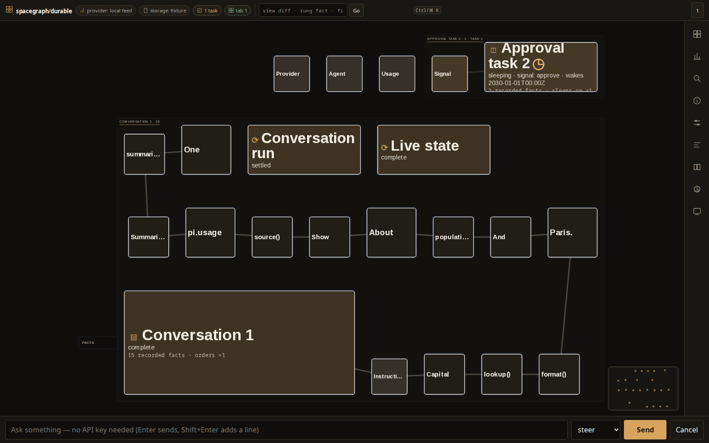
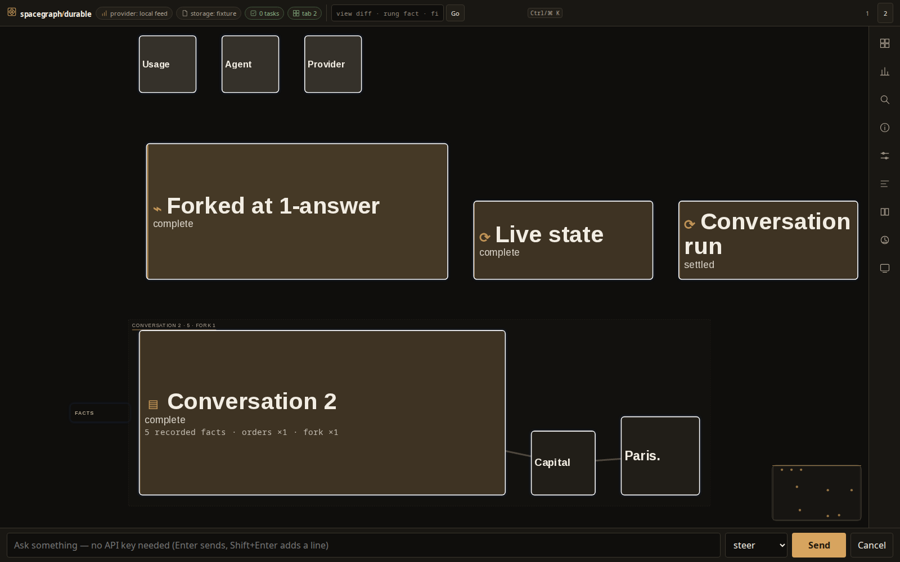

# app/pi-durable

A private workspace consumer that turns durable Pi sessions into a navigable graph. One Node process
owns one Harness; the browser holds conversation views as kernel state and switches tabs without
remounting a session. SpaceGraphJS has no knowledge of Pi, and the library's default host does not
change.





```bash
pnpm install
pnpm --filter pi-durable dev          # server 8788 + Vite 5176 → http://localhost:5176
pnpm --filter pi-durable check:fast   # types + translator/fold/tab tests
pnpm --filter pi-durable verify:fast  # check:fast + browser journey
pnpm --filter pi-durable shots:focus  # four Core heroes + before/after pairs
pnpm --filter pi-durable shots:stories # seven story composites
pnpm --filter pi-durable shots:all    # heroes + stories
pnpm --filter pi-durable verify:visual
pnpm --filter pi-durable verify       # dependency and docs allowlist guard
pnpm --filter pi-durable build        # static bundle, boots from the local feed
```

No provider, key or fixture command is needed: the default Harness uses a faux provider over JSONL
storage in the gitignored `.pi-durable/` directory. `PI_DURABLE_PROVIDER=openai` opts into a live
OpenAI model with `OPENAI_API_KEY` and an optional `PI_DURABLE_MODEL`; it skips faux fixture seeding,
reports its mode in `/api/health`, and returns a typed `no-provider` error without a key. Named
scenarios stay offline in that mode. `PI_DURABLE_PROVIDER=local` connects through Pi AI's
OpenAI-compatible provider to a local `llama-server` (no key, no network); start it with, for example,
`llama-server -m /home/me/gguf/Qwen_Qwen3.5-0.8B-Q4_K_M.gguf --host 127.0.0.1 --port 9931 -c 2048
-ngl 0 --reasoning off`, then set `PI_DURABLE_MODEL_URL=http://127.0.0.1:9931/v1`. The smoke test
(`tests/local-model.spec.ts`) starts its own server on port 9932 and skips when the GGUF is absent.

## First-run journey

1. `pnpm --filter pi-durable dev` with no environment variables.
2. First paint shows the **root** tab, a seeded transcript with order edges, a run node, and one
   sleeping approval task. Badges report `provider: faux · storage: jsonl · 1 task sleeping`.
3. Prompt "Capital of France?" → a user node, then the deterministic "Paris." answer. The form
   stays usable while the run settles; select `steer` or `followUp`, or press **Cancel**
   (`Ctrl+Enter`) to abort the request. The request id is announced and never becomes a fact.
4. The **Tasks** view shows the signal and deadline. **Approve** wakes the task and records its result.
5. Select an entry and press **Fork** (`Shift+R`, or **Fork here** in the inspector) → a new tab
   with a `fork` edge back to that entry; each tab keeps its own selection, camera, view and
   transcript position. **New** (`n`) opens an empty conversation in the same tab strip.
6. `Ctrl+C`, restart: conversations and tasks are recovered from storage; a retried `requestId`
   returns the original submission and adds no second answer.
7. `[` / `]` switch tabs; **Copy** writes a permalink carrying the active tab, view, landmark,
   layout, time and camera. `?at=<codec>` is the compact form of the same address.
8. `/` focuses the prompt, `Enter` submits and `Shift+Enter` adds a line; `↑`/`↓` recall submitted
   drafts. `Ctrl/⌘ K` focuses the Lens (`view diff`, `rung grain`, `as of 2`,
   `tab 2`, `layout radial`, `find Paris`), `?` toggles help, `g` cycles views, `f` focuses the
   selection, `0` resets the view, `Shift+F` enters presentation mode, `Esc` clears overlays,
   `Ctrl+Enter` cancels a prompt, `Shift+R` forks at the selection and `n` opens a new conversation.
   Shortcuts never fire while the composer or another text field has focus.
   Landmarks grade attention on one kernel; they never filter committed facts. The survey plate maps
   node positions through `Navigation.project`; click or arrow keys pan. Export produces JSON, a
   session document, SVG or Markdown.
9. `pnpm --filter pi-durable build` serves the same page from a local op feed with no server.

Keyboard traversal, a roving-tabindex ARIA tablist with RTL arrows, live announcements, 44px
targets, glossary tooltips and a narrow layout are part of the gate, not polish.
`tests/a11y.spec.ts` checks all of them; `tests/resume.spec.ts` stops and restarts a server on an
isolated JSONL directory to prove recovery without a duplicate answer.

## Scenarios and URL state

`?scenario=<id>` boots one named fixture without a server; `?shot=<id>` does the same and selects the
shot's view. `src/scenarios.ts` is the single catalog: each row names a `Core` or `Next` coverage row
from the plan, a deterministic view, tasks, expected stable ids and the test that guards it. `?s=<tab>`
restores the active tab; `?seed=<name>` varies faux answers for capture runs. `?replay=<id>` folds a
deferred `app.replay` action list onto the local feed; `?asOf=<seq>` reads a stored earlier entry
point with a badge and no commit controls; `?observer=1` renders a second process's read-only
`/events/observe` stream. `?rung=<landmark>` addresses `cosmos … grain`, `?layout=grid|radial|timeline`
feeds one scope simulation, and `?view=<name>`/`?zoom=<value>` restore the placement. Permalinks carry
tab, shot, view, landmark, layout, time and camera. Named scenarios and replay stay offline in live
provider modes.

Four Core heroes are tracked at full resolution: `basic-turn`, `sleeping-approval`, `fork-tabs` and
`resumed`. Seven story composites replace the wall of near-duplicate `Next` frames: `turn-flow`,
`task-wake`, `fork-journey`, `resume-journey`, `inspect-flow`, `host-boundary` and `child-flow`. Each story captures
four states from pure `?shot`/`?scenario` state through `window.__durable` hooks, then composes them
in a browser canvas. Each cell is an engraved plate: a survey mark, landmark legend and scale bar
alongside its numbered caption. The active story follows `?story=<id>` or the first story containing `?shot`, and its frames are
scrubbable through `setStory` / `chapters` /
`scrub`; the PNG is the printed plate and the hooks are the film. Views `diff`, `trace`, `docs` and
`transcript` is a readable DOM projection of the same folded kernel, built by the shared
`spacegraphjs/reading` helper: ordered sections, escaped committed text and a backlink on every
fact that restores the graph selection. Reader sections are tabbable; `↑`/`↓`, `Home`/`End` and
`Enter` navigate and reveal without leaving the keyboard. `diff`, `trace` and `docs` re-place the same kernel and are
represented inside those stories, not as new renderer contracts.
`pnpm --filter pi-durable shots:all` captures heroes and stories; the contact
sheet keeps before/after pairs without writing a verdict.

## Environment

| Variable | Default | Purpose |
| -------- | ------- | ------- |
| `PI_DURABLE_LOCAL_FEED` | off in dev | Marks the browser harness as a local fixture run |
| `PI_DURABLE_STORAGE` | `jsonl` | `jsonl`, `memory` or `sqlite` store |
| `PI_DURABLE_DIR` | `.pi-durable` | JSONL directory; an isolated directory is used by the restart test |
| `PI_DURABLE_PROVIDER` | `faux` | `faux` (default), `openai` or `local` / `llamacpp` (live modes) |
| `PI_DURABLE_MODEL` | `gpt-4o-mini` / `local-model` | Model id for live modes; faux mode always uses `faux-1` |
| `OPENAI_API_KEY` | unset | Required for `openai`; otherwise prompts fail with typed `no-provider` |
| `PI_DURABLE_MODEL_PATH` | unset | GGUF path for `local` mode, validated at boot (`model-unavailable` if unreadable) |
| `PI_DURABLE_MODEL_URL` | `http://127.0.0.1:9931/v1` | OpenAI-compatible endpoint served by a local `llama-server` |
| `PI_DURABLE_MODEL_CTX` | `2048` | Context window for the local model |
| `PI_DURABLE_MODEL_MAX_TOKENS` | `256` | Maximum generated tokens for the local model |
| `PI_DURABLE_TEST_GGUF` | 0.8B Qwen path | GGUF used by the offline local-model smoke test |
| `PI_DURABLE_FAUX_SEED` | `fixed` | Keeps screenshot answers deterministic |
| `PI_DURABLE_SERVER_PORT` | `8788` | Node server port |
| `PI_DURABLE_WEB_PORT` | `5176` | Vite port |
| `SG_DURABLE_SHOTS` | `docs/screenshots` | Screenshot output directory |
| `SG_DURABLE_SHOT` | heroes | Comma-separated hero shot ids |
| `SG_DURABLE_STORY` | all | Comma-separated story ids |
| `PI_DURABLE_OBSERVER` | `0` | Open the JSONL directory read-only; commits return typed `read-only` |
| `PI_DURABLE_OBSERVER_URL` | — | Observer base URL advertised by the owner server |
| `PI_DURABLE_OBSERVE_IDS` | — | Extra conversation ids an observer may watch |
| `PI_DURABLE_CONFORMANCE` | `0` | Run upstream storage conformance at boot; results at `/api/conformance` |
| `PI_DURABLE_CODEMODE` | `0` | Install the code-mode workshop in the server registry; advertised by `/api/health` |
| `PI_DURABLE_IMAGES` | `0` | Install Photon's fit workshop; image artifacts are read from committed `data` |

## Server API (Core)

| Route | Purpose |
| ----- | ------- |
| `GET /events` | One SSE stream; `id:` is the conversation id and `data:` is one `KernelOp` |
| `GET /api/health` | Harness state, storage, provider, recovered task count and installed workshops |
| `GET /events/observe` | Read-only SSE stream from an observer process |
| `GET /api/observer` | Observer URL advertised by the owner |
| `GET /api/conformance` | Storage conformance results when enabled |
| `GET /api/conversations` / `POST /api/conversations` | Conversation registry |
| `POST /api/conversations/:id/prompt` | `{ text, mode: steer\|followUp, requestId }` |
| `POST /api/conversations/:id/fork` | `{ entryId }` → new conversation |
| `POST /api/conversations/:id/signal` | `{ key, value }` wakes a sleeping task |
| `POST /api/conversations/:id/abort` | Withdraw queued work |
| `GET /api/scenarios` / `POST /api/scenarios/:id/load` | Named sessions |
| `GET /api/export?format=json\|session\|svg\|md` | Model, session document, SVG or transcript |

Errors are typed (`no-provider`, `unknown-conversation`, `run_failed`, `turn_limit`, `invalid_park`,
`read-only`) and carry a recovery action instead of a stack.

## Layout

- `src/server.ts` — the only file that imports Pi packages: Harness, faux models, registry, JSONL
  storage, routes and the single SSE stream.
- `src/translator.ts` — pure `Durable view → AgentEvent → KernelOp` translation. Stable ids,
  one node per fact, no inferred cause.
- `src/scenarios.ts` — one deterministic fixture per coverage row, with expected ids and tests.
- `src/local-feed.ts` — deterministic ops for the built page and every shot.
- `src/client.ts` — one `EventSource` demultiplexed on `lastEventId`; DOM and keyboard binding.
- `src/host.ts` — one renderer restored from the active tab's kernel and view state; kit `buildScopes`
  feeds one `ScopeSimulation`, which places the graph, tasks and timeline views of that same kernel.
  Cards show friendly labels and committed detail (status, signal, wake time, head, error), edges are
  captioned with their recorded kind, and the collapsible panel carries a status/edge legend.
- `src/attention.ts` — `ScaleDomain` samples landmarks into continuous attention weights; a low
  weight mutes a fact, it never deletes it.
- `src/octaves.ts` — one power-of-two size ladder (`8 … 512`) driven by committed role and the
  attention sample. `sizeForOctave` feeds the adapter's CSS width/height, the renderer footprint and
  layout collision, so the DOM and the canvas agree. Bands are `dot`, `chip`, `card`, `panel` and
  `monument`; focus raises a node to at least the card band without moving it. Landmark roles keep
  the upper rungs of the ladder; message, action and artifact roles sit lower, so conversation, run
  and task lead while attached detail stays present. Labels scale with the
  band, and `dot` cards show a short first word while `title`, `aria-label` and the inspector keep the
  full committed name. The core `solveNodeAreaDensity` hint scales the whole ladder uniformly so nodes
  cover a useful share of the stage (target `0.6`, scale capped at `16`; the E2E gate holds measured
  coverage at 20–35%). `solveErgonomicLayout` supplies compact positions that the simulation still
  owns. Card type uses container units, so labels grow with the node instead of staying fixed-size.
- `src/host.ts` — `#groupFrom` turns recorded owner, wait and `orders` edges into subgraph frames via
  the adapter's band seam; each rung adds a different committed-detail caption to the cards. Zooming
  changes representation, never the kernel or its edge set.
- `src/edge-style.ts` — recorded edge kinds map to the renderer's solid/dashed/dotted and confidence
  channels, a monochrome glyph in each caption, and arrowheads on directed kinds. Colour stays
  theme-owned because the renderer contract has no edge-tone field. Cards carry a kind glyph from the
  same flat icon grammar; neither changes the committed fold.
- `src/provenance.ts` — "why is this here?" reads the folded kernel and entry log; it reports commit
  sequence, source entry, order neighbours, view facet and edge kinds without inventing a cause.
- `src/lens.ts` — one command grammar for view, landmark, time, tab, layout, find, `focus <id>` and
  `why`.
- `src/address.ts` / `src/chapters.ts` — compact permalink codec (including the focused node) and
  the hooks behind scrubbable plates.
- `src/shots.ts` — shot catalog; `?shot=<id>` reproduces each state from pure data.

The shared pipeline lives in `app/pi-kit` (ops/demux, `TabRegistry`, session/workspace state, scope
builder, theme, fixtures). It imports no Pi and no UI chrome. `app/pi` re-exports its `ops.ts` from the same kit;
neither app's state machine is shared.

## Glossary

A **conversation** owns a transcript of committed **entries**. A **commit** is one atomic durable
write. A **doc** is a built-in view such as `pi.live`, `pi.inbox` or `pi.usage`. A **task** is a durable
state machine that can sleep on a **signal**. A **fork** starts a new conversation at an existing
entry. Edges are drawn only for links Durable records.

Upstream design: [pi-durable spec](https://github.com/earendil-works/pi/tree/main/packages/durable).
Pin 1.6.0; the API changes without notice between releases.

## Troubleshooting

- `Pi import outside server.ts` from `pnpm --filter pi-durable verify`: move the import into the
  server adapter; the kit and library never depend on Pi.
- Empty canvas after a build: open the page without `?shot`; the static bundle boots from the local
  feed and needs no server.
- A shot looks stale: `pnpm --filter pi-durable shots:focus` copies the old PNG to `.prev` and writes
  a contact sheet with before/after pairs. No verdict is written automatically.

## Chrome and icons

The canvas owns the frame. A 56px icon rail holds the controls; their text lives in `aria-label`,
`title`, the announcer and one collapsible panel opened from the rail. The panel is the home for
views, landmarks, inspector, controls, legend, glossary and insights. The insights panel carries a
time scrubber with one tick per committed entry, a change digest from `diffKernels`, and an instrument
panel behind `?instruments=1`. At 900px and below the rail slides out from the header menu. `Shift+F`
toggles presentation mode, `f` focuses the selected node, `0` resets the view, `Alt+←`/`Alt+→` walk
discrete view history, `Ctrl/⌘ K` opens the Lens, `?` lists every binding, and `Esc` closes the panel
and restores focus to its icon. Lens keeps query history (`↑`/`↓`) and completes command prefixes on `Tab`.
The insights panel also drives guided routes, curiosity callouts, kind/status muting chips, the commit
ticker and thread following; `e` toggles a focus lens on the selection and `m` resets muting filters.
Its Compare block pins a tab or selected node as reference and clears back to the prior view. Dot and
chip cards reveal their full committed summary on hover, and keyboard focus raises them to the card
band and writes the summary into the inspector without changing the fold. Muting dims facts without
removing nodes, edges or documents, and `Esc` restores a thread or focus lens.

The visual language is warm ink on vellum-dark: charcoal panels, hairline rules, square corners and
an amber accent. Theme tokens own every colour on both the canvas and the chrome; no glass, glow,
parallax or bounce is used.

Icons are decorative inline SVG `<symbol>` definitions in `index.html` — survey mark, views grid,
landmark rungs, lens, inspector, controls sliders, legend rules, glossary book, insights dial, tasks
checkbox, documents, signal bars, menu, close and presentation screen. Theme tokens own their colour;
there is no icon font or new dependency. The same survey grammar is used by the header badges and the
Lens command form in the top menu bar, so no overlay cuts into the graph.
